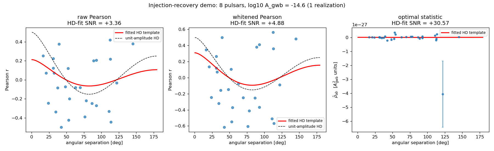
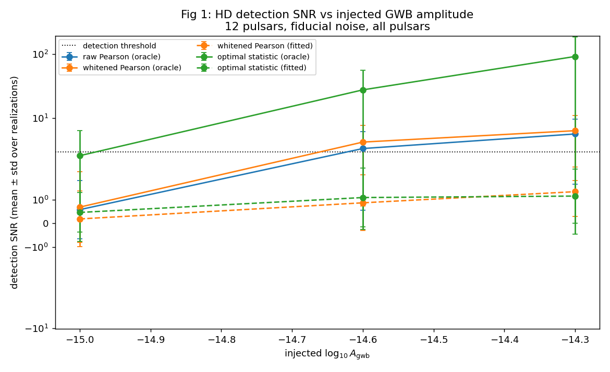
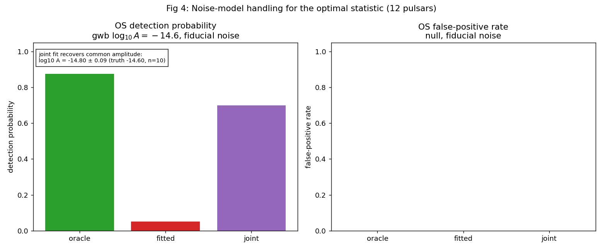
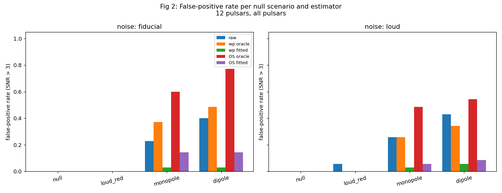

# Testing the Robustness of Gravitational-Wave Correlation Measurements Under Realistic Pulsar Noise

**Python · Statistical modeling · Monte Carlo simulations · Astrophysics**

When pulsar-specific noise and measurement uncertainties are varied under
controlled conditions, which correlation analysis methods reliably recover a
gravitational-wave background's expected angular correlation pattern — the
Hellings–Downs curve?

This project answers that question with simulation-based validation. Instead
of only studying correlations already present in real data, we generate
pulsar-timing datasets where the ground truth is known in advance, then
measure when each analysis succeeds, when it fails, and why.

It extends [Project 1](https://github.com/Akashmanda001/nanograv-noise-modeling-robustness)
(which computed Pearson correlations on NANOGrav 15-year residuals,
before/after whitening, grouped by RMS-reduction) by testing whether a change
in correlations reflects a genuine common signal, pulsar-specific noise, or a
limitation of the analysis method.

## Honest framing

This is a **reproducible comparison of the specific whitening and selection
choices from Project 1** — not an invention of injection-recovery testing.
Simulation-based injection-recovery and posterior predictive checks are
established, standard practice in PTA research, including NANOGrav's own
work. The contribution here is a clearly defined, open comparison of three
specific estimators on realistic simulated data, with the code and seeds to
reproduce every number.

## The method ladder

| # | Estimator | What it does |
|---|-----------|--------------|
| 1 | Raw Pearson | Pairwise Pearson r on epoch-matched residuals (the Project-1 baseline) |
| 2 | Whitened Pearson | Whiten each pulsar by its intrinsic noise model first, then epoch-matched Pearson |
| 3 | Optimal statistic | Noise-weighted Hellings–Downs matched filter |

One correction worth making explicit: the noise-weighted pairwise estimator
**is** the PTA optimal statistic (Chamberlin et al. 2015) — there is no
separate "later" optimal statistic to build. The full Bayesian hierarchical
analysis is the genuine later extension (planned v2).

## Simulation design

- **Array:** 12 pulsars with NG15-mimicking observing schedules — 15-year
  baseline, ~monthly cadence with jitter and dropouts, lognormal TOA
  uncertainties (a loader for real `.tim` files is provided, but no
  NANOGrav data is bundled or downloaded).
- **Noise:** per-pulsar white noise (EFAC/EQUAD) plus power-law red noise
  realized through a Fourier-basis Gaussian process.
- **Signal injection:** Hellings–Downs-correlated red noise via Cholesky of
  the HD spatial covariance, at log₁₀ A ∈ {−15.0, −14.6, −14.3}.
- **Null scenarios:** pure null; loud *uncorrelated* red noise in two
  pulsars; common monopole (clock-like) and dipole (ephemeris-like)
  systematics.
- **Sweep:** 605 realizations / 8,490 estimator rows, deterministic seeds
  (`BASE_SEED=20261014`), across scenarios × noise strengths × Project-1-style
  selection groups × estimators × noise-model handling (oracle vs per-pulsar
  ML fits vs joint array fit). Exact grid in `results/manifest.json`; raw
  data in `results/sweep_raw.npz`.



## Headline findings

Full write-up in [`results/RESULTS.md`](results/RESULTS.md). Detection =
HD-template-fit SNR > 3.

**1. The optimal statistic dominates detection; whitening helps Pearson
modestly.** Fiducial noise, oracle noise models, detection probability at
SNR > 3:

| log₁₀ A_gwb | raw Pearson | whitened Pearson | optimal statistic |
|---|---|---|---|
| −15.0 | 0.03 | 0.07 | **0.43** |
| −14.6 | 0.50 | 0.60 | **0.88** |
| −14.3 | 0.80 | 0.80 | **0.93** |

Whitening before correlating is a consistent but small win over raw Pearson —
the Project-1 effect, now with a measured size. The optimal statistic is in
a different league, as theory predicts.



**2. The noise-model degeneracy is severe — and quantified.** Replacing
oracle noise models with realistic per-pulsar ML fits collapses every
estimator (GWB −14.6, fiducial): optimal statistic detection probability
0.88 → **0.05**, whitened Pearson 0.60 → **0.03**. The mechanism, confirmed
in the fits: with no common term in the model, common power is absorbed
into "intrinsic" red noise (fitted spectral indices slam into the γ = 7
bound), and the recovered amplitude is biased **low by 60–75%**. A joint
array fit with a global common term recovers most of the loss (detection
0.70, zero false positives, amplitude log₁₀ A = −14.80 ± 0.09 vs truth
−14.60) — the poor-man's version of the common-process modeling real
analyses use.



**3. False positives: uncorrelated red noise is safe; systematics are
not.** Pure null and loud uncorrelated red noise give ≈ zero false HD
detections for all estimators. But common monopole/dipole systematics
project onto the HD template and fool it — false-positive rates
0.60/0.77 for the optimal statistic — and *the better the estimator, the
more confidently fooled*. This is exactly why real PTA analyses run
monopole/dipole consistency checks alongside the HD search.



**4. Selection by whitening response: an honest null result.** Project-1-style
RMS-reduction groups neither clearly help nor clearly hurt: the Moderate
group performs about the same as the full array, the Weak (white-dominated)
group cannot detect, and the Strong group is too sparse to evaluate.

## Limitations (read before citing)

- **Residual-level injection.** No timing-model fit; real analyses absorb
  part of any common signal into the fit. Estimator performance here is an
  upper bound vs a full pipeline.
- **12 pulsars, synthetic schedules.** Smaller than NG15's 68 pulsars;
  detection probabilities do not transfer directly.
- **ML noise fits, not Bayesian.** The degeneracy finding uses point-estimate
  ML; a full hierarchical Bayesian treatment (planned v2) could behave
  differently.
- **Small joint grid** (n = 10/cell — wide error bars) and reduced
  fitted-model search settings for speed.
- **Strong selection group inconclusive** (too sparse); systematic amplitude
  fixed at a single value.

## Reproduce it

```bash
pip install -r requirements.txt
python3 demo/run_demo.py          # ~1 s: one realization, all three estimators
python3 stage2/run_sweep.py       # ~33 min: full Monte Carlo sweep (605 realizations)
python3 stage2/analyze.py         # regenerates results/figures from sweep_raw.npz
```

Deterministic seeds throughout (`BASE_SEED=20261014`). No data files are
bundled or downloaded; no network access needed.

## Repository layout

```
.
├── README.md            # this file
├── DESIGN.md            # full design doc: simulator, estimators, metrics,
│                        #   development lessons, v2 extension plan
├── LICENSE              # MIT
├── requirements.txt     # numpy, scipy, matplotlib only
├── src/
│   ├── simulate.py      # pulsar array simulator (white/red noise,
│   │                    #   HD-correlated injections, null scenarios)
│   ├── estimators.py    # the three estimators + noise-model fitters
│   └── metrics.py       # detection SNR, bias/RMSE, false-positive rate
├── demo/
│   ├── run_demo.py      # one injected realization, 8 pulsars, all estimators
│   └── figures/         # demo output figure
├── stage2/
│   ├── run_sweep.py     # Monte Carlo sweep (writes results/sweep_raw.npz)
│   └── analyze.py       # aggregates results into figures + tables
└── results/
    ├── RESULTS.md       # Stage-2 write-up: findings, numbers, limitations
    ├── manifest.json    # exact sweep grid, seeds, timings
    ├── sweep_raw.npz    # raw per-row sweep data
    └── figures/         # fig1–fig5
```

## Related work

- [Project 1: nanograv-noise-modeling-robustness](https://github.com/Akashmanda001/nanograv-noise-modeling-robustness) —
  the exploratory analysis on real NANOGrav 15-year data this project
  validates by simulation.
